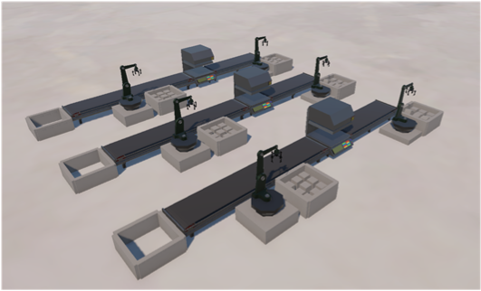
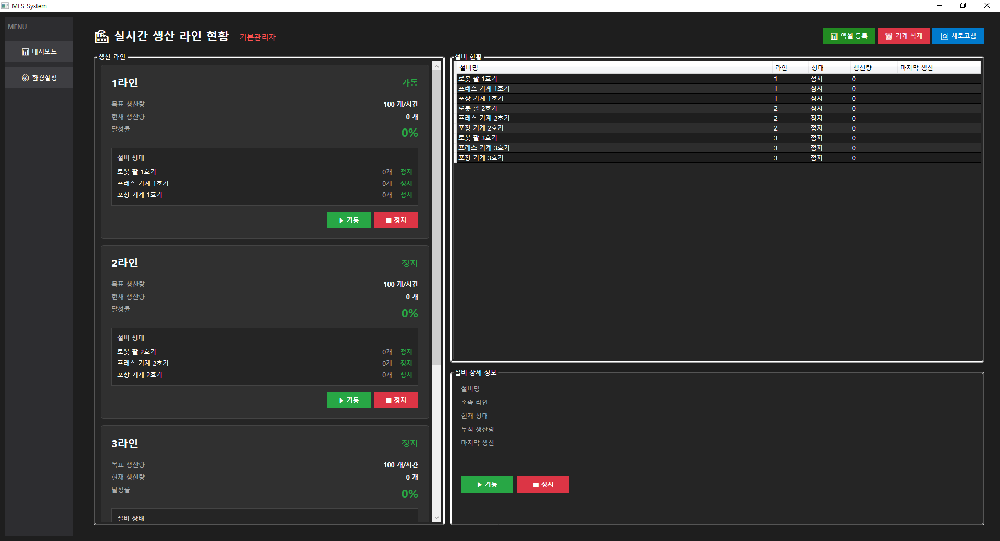

# 실시간 설비 모니터링 및 TCP 통신 시스템

Unity 기반 설비 시뮬레이터와 WPF 클라이언트를 중앙 TCP 서버로 연결하여
설비 상태와 생산 데이터를 실시간으로 주고받도록 구현한 프로젝트입니다.

실제 PLC나 생산 설비 대신 Unity로 가상의 생산설비를 구성하고,
생산량 및 상태 정보를 서버로 전송하여 WPF 클라이언트에서 확인하고 제어할 수 있도록 구현했습니다.

---

## 목차

- [개발 목적](#개발-목적)
- [시스템 구조](#시스템-구조)
- [주요 기능](#주요-기능)
- [통신 방식](#통신-방식)
- [Packet Command](#packet-command)
- [Troubleshooting](#troubleshooting)
- [Tech Stack](#tech-stack)
- [실행 방법](#실행-방법)
- [프로젝트 구조](#프로젝트-구조)
- [실행 화면](#실행-화면)
- [프로젝트를 통해 경험한 내용](#프로젝트를-통해-경험한-내용)

---

## 개발 목적

스마트팩토리 환경에서 사용되는

- 설비 데이터 수집
- 설비 상태 모니터링
- 생산량 동기화
- 원격 설비 제어
- 서버 기반 데이터 관리

구조를 직접 구현해 보기 위해 제작했습니다.
실제 산업 설비 대신 Unity를 설비 시뮬레이터로 사용하여 `설비 → 서버 → 클라이언트` 형태의 데이터 흐름을 구현했습니다.

---

## 시스템 구조

```text
┌────────────────────────────┐
│      Unity Simulator       │
│                            │
│ EquipmentData              │
│ MachineNetworkSender       │
│ MachineNetworkReceiver     │
└─────────────┬──────────────┘
              │
              │ TCP / JSON (Port 5000)
              ▼
┌────────────────────────────┐
│     Central TCP Server     │
│                            │
│ ClientManager              │
│ UnityPacketHandler         │
│ WPFPacketHandler           │
│ PacketSender               │
│ Repository → SQLite        │
└─────────────┬──────────────┘
              │
              │ TCP / JSON (Port 5000)
              ▼
┌────────────────────────────┐
│         WPF Client         │
│                            │
│ ServerConnection           │
│ NetworkService             │
│ PacketHandler              │
│ ViewModel                  │
└────────────────────────────┘
```

---

## 주요 기능

### Unity 설비 시뮬레이터

- 생산 설비(로봇 팔, 프레스, 컨베이어 등) 동작 시뮬레이션
- 설비별 MachineId 관리
- 설비 가동 / 정지 상태 관리
- 생산 발생 시 생산량 증가 및 서버로 전송
- 전체 설비 상태를 주기적으로 서버에 일괄 전송 (Heartbeat)
- 서버의 라인 제어 명령에 따라 설비 가동 / 정지
- 연결 시 서버 데이터 기준으로 초기 상태 동기화
- 설비 클릭 시 장비명 / 현재 상태 / 누적 공정 횟수 표시

### TCP Server

- Unity / WPF 클라이언트 연결 관리
- 최초 메시지로 클라이언트 역할 구분 (`Unity` / `WPF`)
- 줄 단위 JSON 패킷 송수신
- Unity 생산 데이터 수신 및 SQLite DB 반영
- WPF 클라이언트에 설비 / 라인 상태 전달
- WPF의 라인 제어 명령을 Unity로 전달
- Excel 파일을 받아 설비 일괄 등록

### WPF Client

- **대시보드**
  - 생산 라인 카드: 라인 상태, 목표 생산량, 현재 생산량, 달성률, 소속 설비 목록
  - 라인 단위 ▶가동 / ■정지 제어
  - 설비 목록 DataGrid (설비명, 라인, 상태, 생산량, 마지막 생산 시간)
  - 설비 상세 패널 및 설비 상태 변경
  - 엑셀 등록 / 설비 삭제(다중 선택) / 새로고침
- **환경설정**
  - 관리자 이름 설정 → 대시보드 상단에 표시 (`WeakReferenceMessenger`)
- 서버 연결이 끊기면 5초 간격으로 자동 재연결

---

## 통신 방식

### 클라이언트 역할 구분

TCP 연결 후 클라이언트는 첫 줄로 자신의 역할을 서버에 전달합니다.

```text
Unity
```

또는

```text
WPF
```

서버는 이 값으로 클라이언트를 구분하며, 그 외의 값이면 연결을 종료합니다.

```text
Unity Client → 생산 데이터 / 설비 상태 송신, 라인 제어 명령 수신
WPF Client   → 설비 / 라인 데이터 조회, 제어 요청
```

### 줄 단위 JSON 비동기 통신

Unity, Server, WPF 간 통신은 비동기 방식으로 구현했으며,
패킷은 한 줄 단위 JSON 문자열로 전달합니다.

```text
Client
  ↓ WriteLineAsync()
TCP Stream
  ↓ ReadLineAsync()
Server
```

서버 → 클라이언트 패킷은 `Command` + `Data` 형태의 공통 구조를 사용합니다.

```json
{
  "Command": "INIT_MACHINE",
  "Data": [
    { "Id": 1, "Name": "로봇 팔 1호기", "Status": "가동", "ProductionCount": 120, "LineId": 1 }
  ]
}
```

WPF에서는 패킷 종류에 따라 DTO를 분리하여 역직렬화합니다.

```csharp
public class MachineListPacket : BasePacket
{
    public List<Machine>? Data { get; set; }
}
```

### 생산 데이터 처리 흐름

Unity에서 생산이 발생하면 설비의 생산량을 증가시키고 서버로 전송합니다.

```text
Unity
  ↓ ProductionUpdate
TCP Server
  ↓ DB 갱신
WPF Client Refresh
```

```json
{
  "Command": "ProductionUpdate",
  "Id": 1,
  "Status": "가동",
  "ProductionCount": 120,
  "LastProductionTime": "2026-10-19 14:30:00"
}
```

서버는 저장된 값보다 큰 생산량만 반영하여, 늦게 도착한 패킷이 생산량을 되돌리지 않도록 했습니다.

### 라인 제어 흐름

WPF에서 라인 가동 / 정지를 요청하면 서버가 라인과 소속 설비의 상태를 갱신한 뒤 Unity로 전달합니다.

```text
WPF Client
    ↓ CONTROL_LINE
TCP Server  (Line / Machine 상태 DB 갱신)
    ↓ CONTROL_LINE
Unity Simulator
    ↓
라인 설비 가동 / 정지
```

> 설비 단위 제어(`CONTROL_MACHINE`)는 서버 DB의 상태만 변경하며 Unity로 전달되지 않습니다.

### 설비 상태 동기화

Unity 내부 생산량과 서버 DB 생산량이 달라지지 않도록, 서버 데이터를 기준으로 초기 상태를 맞춥니다.

```text
Unity 연결
    ↓
서버에서 INIT_MACHINE 전달
    ↓
Unity EquipmentData 초기화
    ↓
이후 생산 발생 → ProductionUpdate 전송
    ↓
서버 DB 갱신
```

### Excel 설비 일괄 등록

WPF에서 `.xlsx` 파일을 선택하면 Base64로 인코딩하여 서버로 전송하고,
서버는 EPPlus로 파일을 읽어 설비를 일괄 등록합니다.

| 열 | 내용 |
|---|---|
| A | 설비명 |
| B | LineId |

- 2행부터 읽습니다(1행은 헤더).
- 존재하지 않는 LineId는 라인을 자동 생성합니다.
- 등록 후 모든 WPF 클라이언트에 목록을 갱신합니다.

---

## Packet Command

| Command | 방향 | 설명 |
|---|---|---|
| `INIT_MACHINE` | Server → WPF / Unity | 초기 설비 데이터 전달 |
| `INIT_LINE` | Server → WPF | 초기 생산 라인 데이터 전달 |
| `REFRESH_LIST` | WPF ↔ Server | 설비 목록 갱신 요청 / 전달 |
| `REFRESH_LINE` | Server → WPF | 라인 목록 갱신 전달 |
| `ADD_MACHINE` | WPF → Server | 설비 추가 |
| `REMOVE_MACHINE` | WPF → Server | 설비 삭제 |
| `CONTROL_MACHINE` | WPF → Server | 설비 상태 변경 (DB) |
| `CONTROL_LINE` | WPF → Server → Unity | 라인 가동 / 정지 제어 |
| `IMPORT_EXCEL` | WPF → Server | Excel 기반 설비 일괄 등록 |
| `ProductionUpdate` | Unity → Server | 단일 설비 생산 데이터 전송 |
| `Heartbeat` | Unity → Server | 전체 설비 상태 주기적 일괄 전송 |

Command 문자열은 `Commands.cs`에 상수로 정의하여 서버와 WPF가 함께 사용합니다.

---

## Troubleshooting

### 1. UTF-8 BOM으로 인한 JSON 역직렬화 오류

**문제**

```text
0xEF is an invalid start of a value
```

**원인**
StreamWriter가 UTF-8 BOM을 포함하여 전송하면서 JSON 문자열 앞에 BOM 문자가 붙었습니다.

**해결**
StreamWriter에서 BOM 없는 UTF-8을 사용하도록 변경했습니다.

```csharp
new UTF8Encoding(false)
```

### 2. 패킷 구조 불일치

**문제**
서버는 `{ "Command": ..., "Data": [...] }` Wrapper 구조로 전송하는데,
WPF에서 `List<Machine>`으로 직접 역직렬화를 시도하여 오류가 발생했습니다.

**해결**
서버 패킷 구조와 동일한 DTO(`MachineListPacket`, `LineListPacket`)를 정의하여 구조를 일치시켰습니다.

### 3. TCP 연결 종료 처리

**문제**
클라이언트 종료 또는 연결 해제 시 다음과 같은 예외가 발생했습니다.

```text
Unable to read data from the transport connection
현재 연결은 원격 호스트에 의해 강제로 끊겼습니다.
```

**해결**

- EndOfStream 검사
- 연결 종료 예외 처리
- 비동기 Read Loop 종료
- 연결 해제된 클라이언트 정리
- WPF는 연결이 끊기면 5초 후 자동 재연결

비정상 종료 상황에서도 서버가 계속 동작하도록 개선했습니다.

### 4. Unity 생산량과 DB 생산량 불일치

**문제**
Unity는 생산량 0에서 시작하지만 DB에는 기존 생산량이 저장되어 있어 서로 다른 값을 표시했습니다.

**해결**
Unity 연결 시 서버가 `INIT_MACHINE` 패킷을 전송하고,
Unity는 이 값을 기준으로 초기화한 뒤 이후 변경분을 서버로 전송하도록 구성했습니다.

### 5. 비동기 패킷 송신 충돌

**문제**
여러 패킷을 동시에 송신하면 같은 Stream / Writer에 여러 작업이 동시에 접근할 수 있었습니다.

**해결**
Unity, Server, WPF의 송신부에 `SemaphoreSlim`을 적용하여 송신 작업을 직렬화했습니다.

```csharp
await _sendLock.WaitAsync();

try
{
    await writer.WriteLineAsync(json);
}
finally
{
    _sendLock.Release();
}
```

---

## Tech Stack

| 구분 | 기술 |
|---|---|
| Client | Unity (Input System, TextMeshPro, DOTween), WPF |
| Server | .NET 8 Console, TcpListener / TcpClient |
| Language | C# |
| Protocol | TCP, 줄 단위 JSON (System.Text.Json / JsonUtility) |
| Database | SQLite, Entity Framework Core 8 |
| Library | CommunityToolkit.Mvvm, EPPlus |
| Architecture | MVVM, Repository Pattern, Client / Server |

---

## 실행 방법

### 요구 사항

- Windows
- .NET 8 SDK (서버 / WPF를 소스에서 실행하는 경우)

### 실행 순서

```text
1. TCP Server  →  2. WPF Client  →  3. Unity Simulator
```

### 1. TCP Server

Visual Studio에서 `UnityTcpMonitoring/UnityTcpMonitoring.sln`을 열고 `UnityTcpMonitoringServer`를 실행합니다.

```bash
dotnet run --project UnityTcpMonitoring/UnityTcpMonitoringServer
```

- 기본 TCP Port: `5000`
- 실행 시 SQLite DB(`MiniMes.db`)가 없으면 자동 생성됩니다.
- 새 DB는 비어 있으므로 WPF의 **엑셀 등록**으로 설비를 등록합니다.

### 2. WPF Client

`UnityTcpMonitoring` 프로젝트를 실행하면 `127.0.0.1:5000`의 서버에 자동으로 연결합니다.

> Visual Studio에서 솔루션의 시작 프로젝트를 여러 개로 설정하면 서버와 WPF를 함께 실행할 수 있습니다.

### 3. Unity Simulator

저장소의 `UnityTcpMonitoring_Unity.zip`을 압축 해제한 뒤 `UnityTcpMonitoring.exe`를 실행합니다.

Unity Windows Build는 exe 단독이 아닌 압축 해제된 전체 파일이 필요합니다.

```text
UnityTcpMonitoring.exe
UnityTcpMonitoring_Data/
UnityPlayer.dll
UnityCrashHandler64.exe
D3D12/
```

### Unity Simulator 조작법

| 조작 | 기능 |
|---|---|
| 마우스 휠 버튼 드래그 | 화면 이동 |
| 마우스 휠 위 / 아래 | 화면 확대 / 축소 |
| 설비 클릭 | 설비 정보 표시 |

---

## 프로젝트 구조

```text
UnityTcpMonitoring
├── UnityTcpMonitoring              # WPF Client
│   ├── Services
│   │   ├── ServerConnection        # 연결 / 재연결 / 수신 루프
│   │   ├── NetworkService          # 요청 API
│   │   ├── PacketHandler           # 수신 패킷 처리
│   │   └── PacketSender
│   ├── ViewModels
│   └── Views
│
├── UnityTcpMonitoringServer        # TCP Server
│   ├── Program                     # Listener, 역할 구분
│   ├── Commands                    # Command 상수
│   ├── MesDbContext                # SQLite
│   ├── Services
│   │   ├── ClientManager
│   │   ├── UnityPacketHandler
│   │   ├── WPFPacketHandler
│   │   └── PacketSender
│   └── Repositories
│
├── UnityTcpMonitoringShared        # 공용 Model (Machine, Line)
│
└── UnityTcpMonitoring_Unity.zip    # Unity Windows Build
```

Unity 시뮬레이터 주요 스크립트:

```text
EquipmentData           # 설비 데이터
MachineNetworkSender    # 생산 / Heartbeat 송신
MachineNetworkReceiver  # 서버 명령 수신
UnityMesClient          # TCP 연결
DroneViewerCamera       # 카메라 이동 / 확대
```

> 이 저장소에는 Unity 프로젝트 소스는 포함하지 않으며, Windows 실행 Build만 제공합니다.

---

## 실행 화면

### Unity 설비 시뮬레이터



### WPF 모니터링 화면



---

## 프로젝트를 통해 경험한 내용

- TCP 기반 Client / Server 통신 구조
- 비동기 네트워크 프로그래밍
- JSON 패킷 설계
- Unity와 WPF 간 데이터 통신
- 클라이언트 연결 관리 및 자동 재연결
- 설비 상태 및 생산량 동기화
- Entity Framework Core를 이용한 데이터 관리
- 네트워크 예외 및 연결 종료 처리
- 패킷 송수신 과정에서 발생하는 인코딩 문제 해결
